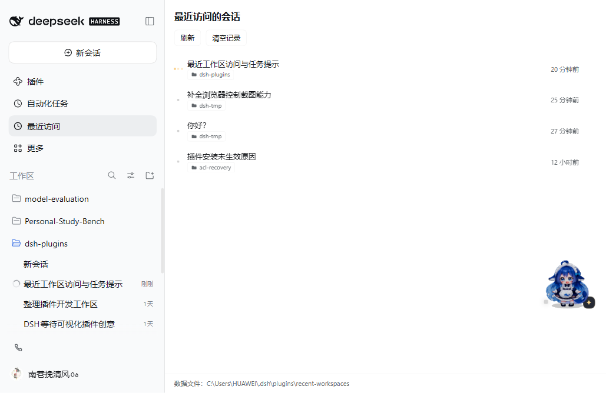

# dsh-recent-sessions · 最近访问

[](https://www.npmjs.com/package/@miloji/dsh-recent-sessions)
[](https://dshopen.org/zh/plugins/%40miloji%2Fdsh-recent-sessions/)

DSH（DeepSeek Harness）侧边栏的**最近访问**面板：**以会话为主**——平铺列出你最近打开过的
会话（跨所有工作区，按“打开时间”倒序，不是按活动排序），每行标注它属于哪个工作区；
正在执行任务的会话，行首显示**三点闪烁等待标志**，一眼就知道任务在进行中。




上图中，第一条会话 `dsh-plugins` 正在执行任务，行首是三个琥珀色闪烁圆点；
其余会话是静态圆点。四条会话分别属于 `dsh-plugins`、`dsh-tmp`、`acl-recovery`
三个不同的工作区。

## 功能

- **最近访问的会话列表**：点击侧边栏时钟图标打开；每行 = 一次最近打开的会话。
- **自动记录访问**：在**任何入口**（原侧栏、本面板、新建会话页）打开会话都会被记录为
  “最近访问”；空白新会话不记录。同一工作区的多个会话各自成行、按各自打开时间排序——
  这正是它和原侧栏工作区分组视图的区别。
- **工作区归属**：每行会话标题下方有工作区徽章（文件夹名，悬停显示完整路径）。
- **三点闪烁等待标志**：正在运行任务的会话，行首显示三个黄色闪烁圆点（CSS 动画）。
- **快速操作**：点击行直接进入会话；悬停行尾 `×` 单独移除；工具栏刷新 / 清空。
- **数据独立存放**：`$DSH_HOME/plugins/recent-workspaces/recents.json`（默认
  `~/.dsh/plugins/recent-workspaces/recents.json`），会话标题与工作区路径存快照。
- **宿主过期提示**：更新插件后若宿主进程仍是旧代码，面板会明确提示重启，而不是空白。

## 安装

```bash
# 一条命令：装进 web profile（把 web 换成你的 profile 名）
dsh plugin --profile web add @miloji/dsh-recent-sessions
```

重启 dsh 后生效（宿主半边的新代码需要进程重载），然后刷新浏览器页面。

**要求**：DSH `>=0.2.0-rc.2 <0.3.0-0`（Web 界面）。纯客户端插件在没有浏览器的 profile
（headless / acp / sdk）里不会显示画面。

**升级已装旧版**：

```bash
dsh plugin --profile web add @miloji/dsh-recent-sessions@latest
```

如果此前装的是本地开发版（`link:` 目录），先用 `dsh plugin --profile web remove <旧包名>`
再装 npm 版，避免同一插件挂两份。

## 数据与隐私

插件只把“会话 id + 工作区路径 + 标题 + 访问时间”写进本机磁盘上的
`recents.json`；不联网、不上传、不读取会话内容。HTTP 接口挂在宿主的 Connection 围栏后面，
未授权请求返回 401。

## 排除故障

- **面板空白**：先看面板是否显示“宿主进程还在运行旧版本插件代码”，是则完整重启 dsh。
- **装了没反应**：打开浏览器控制台，找 `client-modules:` 开头的行；再运行

  ```bash
  node ~/.dsh/skills/dsh-plugin-publish/scripts/verify-install.mjs --name @miloji/dsh-recent-sessions
  ```

## 许可证

MIT